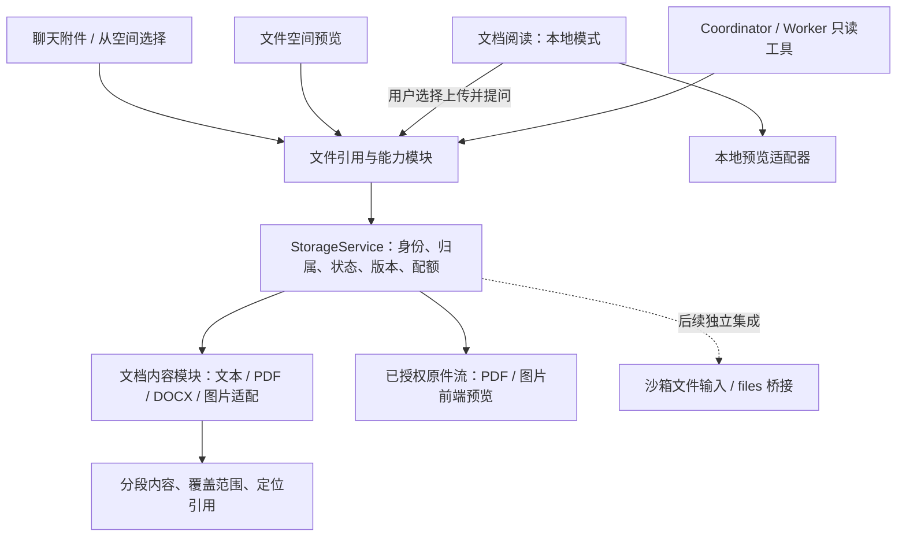

# 文件上传、预览与智能体读取统一方案

状态：已实现首期文件闭环及生成能力，相关验证已完成，真实 MySQL/Linux FUSE 集成待环境验收；实际交付范围与环境限制见 [实施与验证记录](file-workflow-implementation.md)。日期：2026-11-25。

基线：feature/unified-file-workflow，origin/develop @ f8ed56aa。先前研究基于旧工作区，下述 FUSE 事实和实施优先级已据远程最新基线修正。旧工作区未提交修改不纳入本分支。

## 1. 目标与建议结论

保留「聊天框＋」「文件空间」「文档阅读」三个面向用户的入口，共用文件引用、格式能力判断和文档内容读取模块。账号容量、单文件配额、文件数量配额保持现有策略，不以扩容解决问题。

建议优先实现以下闭环（包括用户追加确认的文件生成）：

1. 聊天框可多选、拖入、粘贴文件，支持图片、文本、PDF、DOCX；也可直接选择文件空间已有文件。
2. 文件空间能预览 PDF、Word（第一版明确为 DOCX）、图片和文本，并提供「添加到当前对话」。
3. 智能体通过有权限校验的只读工具列出、查找和分段读取当前用户、当前 workspace 的文件，回答标注文件和页码/段落。
4. 文档阅读共用预览器，保留「只在本机查看」语义。只有用户选择「上传并提问」时才上传、占用服务器配额。
5. 同一服务器文件被多个对话引用时不重复存原件；读取和解析按需执行，不在每条消息中塞入全文。
6. 智能体生成支持格式的文件，通过现有 FUSE 保存到文件空间，确认落盘与元数据后返回可预览/下载的文件卡片。

智能体阅读直接调用可信存储与内容模块。沙箱用于后续计算、分析和产物生成，不作为普通文档阅读的必经步骤。

## 2. 本次核查范围与事实依据

初稿来自旧工作区；实施前已核查 origin/develop。历史 UI 数值仅作背景，实施以 develop 的测试和行为为准：本地阅读已经采用有界字节切片、用户/workspace 存储键及格式检查，不能改回初稿描述的旧逻辑。本设计不推断线上部署配置。

| 现状 | 证据 |
| --- | --- |
| 聊天框仅选择一张 JPEG/PNG/WebP 图片，但可多次添加、粘贴多图 | [Composer.tsx](../../webui/src/modules/student/components/Composer.tsx)，文件 input 无 multiple，选择处理只取 files[0] |
| 聊天上传是图片专用，返回值强制带宽高 | [uploads/controller.py](../../server/uploads/controller.py)、[uploads/schemas.py](../../server/uploads/schemas.py) |
| 单张图片默认 10,000,000 字节、40,000,000 像素、宽高至少 48 像素 | [vision/safety.py](../../server/tools/vision/safety.py)，ImageSafetyLimits |
| 每条聊天消息最多 5 个附件，目前只收 file_name | [web/contracts.py](../../server/web/contracts.py)，ChatAttachment、SubmitChatBody、ChatSendPayload |
| Gateway 将附件持久化成图片文件名和标记文本，不是通用文档引用 | [gateway/core.py](../../gateway/core.py)，_enrich_content_with_attachments |
| 文件空间支持多选，失败时中止剩余上传；当前预览仅 UTF-8 文本前 800,000 字节 | [FilesPanel.tsx](../../webui/src/modules/student/components/FilesPanel.tsx)、[storage/service.py](../../server/storage/service.py)，build_text_preview、preview |
| 文档阅读仅浏览器 file.text()，单文件 3 MiB、截取 800,000 字符、localStorage 存全文 | 同上 FilesPanel.tsx，LearningImportPanel |
| 文件空间已有归属、文件夹、上传、下载、回收站、恢复、转交及预留式配额 | [storage/service.py](../../server/storage/service.py)、[storage/quota.py](../../server/storage/quota.py)、[storage/transfer_service.py](../../server/storage/transfer_service.py) |
| 文件查询按 owner + workspace + active；额度按账号跨 workspace 汇总，回收站仍占容量 | storage/service.py，list_files、get_file、_file_used |
| Nginx 请求体上限 12 MiB，而部分角色单文件上限是 25 MiB | [nginx.conf](../../nginx/nginx.conf)、[storage/policy.py](../../server/storage/policy.py) |
| develop 已实现 FUSE /files 桥接，/workspace 仍为临时目录 | [files_mounts.py](../../server/storage/files_mounts.py)、[filesystem_bridge.py](../../server/storage/filesystem_bridge.py)、[manager.py](../../server/sandbox/manager.py)、[docker_runtime.py](../../server/sandbox/docker_runtime.py)；旧设计稿不能作为未实现的证据 |
| ProjectStorage、沙箱产物持久化是独立机制，不等于文件空间 | [project_storage.py](../../server/sandbox/project_storage.py)、[artifact_persistence.py](../../server/sandbox/artifact_persistence.py) |

已有默认配额继续使用：游客单文件 5 MiB/文件空间 16 MiB/50 项，学生 10 MiB/128 MiB/500 项，教师、开发者、管理员 25 MiB/512 MiB/2,000 项；管理员覆盖继续生效。通用空间和文件空间两个额度桶也保留。

## 3. 三个入口的产品行为

### 3.1 聊天框＋附件

「＋」提供「上传文件」「从文件空间选择」两项。文件可多选，也可拖入；粘贴保持原有图片优先行为，有文件时走同一校验入口，避免把普通粘贴文字误当文件。

- 图片展示缩略图；文档展示类型图标、原名、大小、能力提示。
- 区分排队、上传中、已上传、解析中、可读取、失败、仅可下载。上传完成不等于解析成功。
- 网络/忙碌失败可重试；超限、格式不支持、密码保护等展示具体原因，不提供无效重试。
- 支持取消及移除；一个失败不阻塞剩余上传。发送时必须移除或解决失败附件。
- 第一版保留每消息最多 5 个附件，前端提前限制，后端同样校验；并发上传建议 2 个，可配置。
- 从文件空间选择不复制文件、不再次计费。新上传成功后出现在文件空间可管理的「聊天附件」目录，目录按 workspace 创建；同名文件自动生成不冲突的名称，卡片仍保留原名。
- 新文件原件建议统一记 FILES 桶，并明确提示「保存在文件空间」；旧聊天图片继续按 CORE 原规则，禁止后台静默迁桶。这个新旧计费差异属于明确的产品规则，需要上线说明。
- 从输入框移除只解除草稿关联，不隐式永久删除已上传文件。上传成功但未发送的文件显示为未引用草稿，可在文件空间删除；建议 24 小时后清理仍无任何持久引用且标记为临时的上传，清理周期可配置。用户主动保存后取消临时标记。
- 上传请求使用幂等键，网络重试不重复生成文件或扣额度；取消晚于服务端落盘时，由临时上传回收处理，不只中断前端请求。

发送后保留文件卡片，可从消息打开同一预览器。模型先收到附件清单和内容版本，再按需读取。文件数上限与上下文预算是两回事，不将全文自动拼进 content。

### 3.2 文件空间

现有目录、下载、回收站、文件转交继续使用。增加格式图标、在线预览、读取状态及「添加到当前对话」。文件列表只判断能力，不为所有文件启动解析。

PDF 提供翻页、缩放、页码；DOCX 提供结构化阅读，按原顺序显示标题、段落、表格，明确标注「阅读视图，排版可能与 Word 不同」。图片展示可缩放预览；文本和代码保留高亮，允许分页继续阅读，不再只给无法继续的前缀。

「预览当前页」「让智能体分析此文件」「从此文件生成分析结果」是不同动作。普通预览不触发付费模型、不启动完整 OCR。

### 3.3 文档阅读

保留本地导入与隐私语义，复用 PDF 前端预览器、DOCX 本地阅读适配器和文本查看器。来源明确为「本地文件」或「文件空间」。

- 本地文件不自动对智能体可见；「上传并提问」显示大小及额度影响，完成后生成服务器 file_id。
- localStorage 仅保存少量设置/最近阅读位置；需要刷新后保留原件时使用有总量和逐出策略的 IndexedDB。浏览器额度不是无限的，失败时可继续当次阅读，并告知不会持久保存。
- 不静默将旧 localStorage 文件全部上传。迁移时允许用户导出、选择迁入本地新存储或上传服务器。
- 原有 3 MiB 是本地文本读取的硬编码，不是服务器配额。新本地 PDF/DOCX 按浏览器资源能力设独立上限；不能照搬服务器上限到本机阅读。
- 第一交付可先让服务器文件使用新预览器，本地文本入口保持可用；本地 DOCX/PDF 适配在下一交付补齐，并明确阶段能力。

## 4. 格式支持矩阵

以下是目标能力与阶段，不代表当前已支持。「可上传保存」与「可阅读」分别判断；文件空间现有保存/下载能力不因新增阅读白名单而倒退。

| 格式 | 聊天添加 | 人工预览 | 智能体读取 | 阶段 |
| --- | --- | --- | --- | --- |
| JPEG/PNG/WebP | 支持 | 缩放图片 | 复用 image_analyze 的 OCR/视觉链路，支持 file_id | 一期 |
| TXT/MD/代码/JSON/CSV/TSV | 支持 | 文本、高亮、表格或源码 | 行/段落/行列范围，UTF-8/BOM 优先，受控 GB18030 回退 | 一期 |
| PDF，含文本层 | 支持 | 原始页面 | 按页提取文字，返回页码与覆盖情况 | 一期 |
| DOCX | 支持 | 标题/段落/表格阅读视图 | 按段落/表格片段，保留顺序 | 一期 |
| 扫描/混合 PDF | 支持 | 原始页面正常预览 | 首期对无文本页明确标注需 OCR；后续选页 OCR，不能把空文本当全文已读 | 二期 |
| XLSX | 二期支持 | 工作表/行列范围 | 单元格范围、公式/缓存值说明；计算用沙箱 | 二期 |
| PPTX | 二期支持 | 首先提供逐幻灯片文字视图 | 幻灯片文字，后续再做版面渲染 | 二期 |
| DOC/XLS/PPT 旧二进制 Office | 首期不进入聊天阅读 | 可存、下载，提示转新格式 | 首期不支持 | 后续评估转换成本 |
| ZIP/RAR、音视频、可执行文件及其他二进制 | 不作为聊天阅读附件 | 维持文件空间保存/下载策略，不主动展开 | 不执行、不自动解压读取 | 范围外 |

加密/损坏文件明确返回原因。第一版不接受密码，不执行宏、公式、文档脚本。DOCX 中图片、图表、公式及复杂浮动对象的语义识别不属于首期完整性承诺，应返回未提取元素提示。

## 5. 共用模块与数据流

### 5.1 文件引用

新文件使用现有 UserFileModel 为原件权威记录，增加来源、临时上传状态及关联所需字段/关系，原件不再按三个入口分别保存。

建议通用引用包含：`source_kind(storage|legacy_chat_image)`、`file_id` 或旧 `file_name`、服务端确认的 `name/mime/size/sha256`、`content_version`、能力列表。宽高改为图片可选元数据，不要求所有附件都有宽高。

客户端只提交引用标识；名字、哈希、所有者、存储路径、能力都由服务端重新解析。模型和浏览器均不能指定服务器磁盘路径。

文件引用作为 file_refs 结构化字段，与现有持久化 dispatch_task 在同一事务内保存，包含 file_id、提交时 hash 和展示快照；TurnRecord 返回该字段供历史消息恢复。复用现有 JSON 持久化，不再另建关联表。旧图片标记、旧下载地址保留兼容读取，不批量复制原件。

保留现有 FUSE 覆盖、追加与 truncate 行为，不因聊天引用而禁止沙箱原有写操作。改名/移动不改变 ID；内容变化以 sha256 区分。引用保存提交时 hash，读取时若当前 hash 不同，明确返回版本变化，不能假装读到旧版。首期不为历史版本永久保留额外原件；用户可显式选择读取新版。回收/永久删除后卡片保留展示快照，但内容不可读，缓存不得绕过。

删除会话只删关联，不删除文件空间中主动保存的文件；自动临时清理须检查所有会话、文件转交及保存标记。删除文件时提示受影响对话，仍尊重用户删除，不以隐藏副本继续占用空间。

### 5.2 模块接口

建议新增 `server/documents/`，把识别、受限解析、定位、缓存放在模块内部。HTTP 与工具不分别实现解析器。

对外只暴露少量能力：

- `describe(context, ref)`：已授权元信息、格式能力、当前版本、解析状态。
- `read(context, ref, locator, budget)`：页/段/行/单元格范围；返回内容块、定位、下一个游标、截断与缺失说明。
- `search(context, ref, query, budget)`：仅对指定文件进行有界关键词查找，返回命中片段及定位；一期后半段实现，不先建向量库。

预览器使用结构化内容块或已授权原件流。浏览器不显示模型加工后的摘要来冒充文档原文。PDF 原始页面与提取文字可能不同，要在内容结果中暴露提取能力限制。

`read` 结果至少包含 `file_id/hash/parser_version/blocks/coverage/truncated/next_cursor/warnings`。PDF 页码从 1 开始；DOCX 用段落和表格序号，不伪造 Word 页码；文本用行号。每条块返回可引用定位，回答中的文件引用可点击回到阅读器。

### 5.3 解析与预览技术选型

- PDF 人工预览建议使用自托管 PDF.js，前端按页渲染、释放离屏页面，二进制流受登录保护；不上传第三方在线预览站。[PDF.js 官方说明](https://mozilla.github.io/pdf.js/)
- PDF 智能体文字读取建议先验证 pypdf，按页保留来源；它不提供 OCR，复杂表格、阅读顺序和扫描页都有明确限制。小压缩文件仍可能产生大解压流，因此必须在受限进程运行，不在 FastAPI 事件循环直接解析。[pypdf 提取与内存限制说明](https://pypdf.readthedocs.io/en/stable/user/extract-text.html)
- DOCX 后端建议 python-docx，按文档顺序抽取段落与表格；前端以受控 React 元素渲染阅读块。先不引入 LibreOffice 常驻服务，不承诺精确还原 Word 分页。[python-docx 文档](https://python-docx.readthedocs.io/en/latest/)
- 如果需要更接近 Word 的视觉预览，再验证浏览器 docx-preview/docxjs，与智能体文字读取独立。它本身也受 HTML 表达能力限制，不能替代 Word；必须验证样式隔离、外部关系引用禁用、复杂文件资源预算。[docxjs 官方仓库](https://github.com/VolodymyrBaydalka/docxjs)
- 已有 rapidocr/视觉路由可复用作选页 OCR；还需 PDF 页面栅格化适配和预算控制，不能认为已有图片 OCR 就已支持扫描 PDF。

新依赖在实施时锁定版本并检查许可和安全公告。本次没有安装依赖；选型需要中文 PDF、复杂 DOCX 样本小规模验证后最终确定。

## 6. 智能体工具与权限

建议新增以下工具，先只读：

| 工具 | 输入 | 输出/限制 |
| --- | --- | --- |
| `list_user_files` | parent_id、文件名查询、cursor | 当前用户/current workspace 的有效文件，分页、能力信息；不返回原文 |
| `read_user_file` | file_id、版本、locator、budget | 受限原文及定位、覆盖范围、下一游标 |
| `search_user_file` | file_id、query、cursor | 指定文件内的片段及定位；不做后台全空间向量索引 |

聊天附件可直接 read；用户说「读取文件空间中的某文件」时先 list 查询再 read。同名文件返回路径供模型区分，有歧义再让用户选择。默认只读取本次任务需要的文件，不在普通对话启动时递归枚举全文。可见范围延续现有本人+workspace 文件空间；他人发来的文件必须先接受到自己的空间。

在 ToolRuntime 中注册只读描述、能力、并发、超时、输出预算和审计，同时更新 coordinator/worker 配置。只注册 Python 函数不足以证明模型能用。

可信身份来自 Gateway 的 RunnableConfig/SessionContext，再实时验证登录会话、账号状态、授权版本和 workspace 权限，构造 AuthenticatedPrincipal；模型参数不含 owner_user_id、auth_session_id 或任意磁盘路径。

两项实施前置缺口：

1. [worker_tool.py](../../server/tools/worker_tool.py) 的 tool_config 重建未传 auth_session_id；必须补齐 coordinator → worker → tool 并验证真实数据库登录，禁止失败时回退 local。
2. [read_local_file](../../server/tools/api/file_read_tool.py) 目前只检查路径位于整个 `.data` 内，没有个人文件归属检查。应限制为当前会话工具结果目录或改用受控 artifact ID；不能用该函数绕开 StorageService 直接读用户文件。

文档内容标为不可信外部输入；其中的操作指令不授予额外权限。审计记录文件 ID、定位、版本、耗时、输出大小与失败类别，默认不把全文复制进普通日志。工具结果不额外无界持久化，聊天已有的必要上下文仍按现有额度计量。

## 7. 与已有 FUSE 链路的适配（develop 核查修订）

已存在的链路为：StorageService / UserFileModel → StorageFuseBridge → StorageMountRegistry → Manager claim → Docker bind mount `/files`。挂载按 `(user_id, workspace_id)` 建立。`SANDBOX_ENABLE_FILES_BRIDGE` 控制是否启用，`SANDBOX_FILES_BRIDGE_WRITABLE` 控制写模式；功能上线不能擅自改变默认开关或容器权限。

`bridge_writes.py` 已对 write/truncate/append 执行配额预留，发布新的 blob 后提交元数据并更新 hash。新功能复用这一权威数据，不新增另一套文件持久化，不绕过额度写原始磁盘。`ProjectStorage` 和临时 `/workspace` 也不替代 FUSE。

### 7.1 统一 ID，两种消费方式

- 文件卡片、会话关联、工具以 `file_id + sha256` 为稳定引用。
- 预览、普通文档问答：可信侧通过 StorageService 重新授权，读取一致的 blob，交给受限解析模块。Web/Worker 不直接遍历 Manager 的挂载目录。
- 代码计算：同一授权模块遍历已授权父目录链，返回当前 `/files/目录/文件名` 和 hash，沿用沙箱执行工具。只返回容器内路径，不暴露 storage_key、宿主挂载点和 UUID 原件路径。
- 列表结果包含当前 sandbox_path、格式能力和版本；路径只表示当前映射，不作为永久授权凭据。传给代码时使用安全的字符串序列化，禁止把文件名直接拼接进 Python 源码。
- 图片仍走现有视觉工具，补 file_id 适配，不把多种文档都伪装成图片文件名。

### 7.2 保持已有沙箱行为

不重写 FUSE、Manager claim、Docker mount、回收与现有读写流程；只补文件 ID/路径解析和必要身份传递。新生成文件由现有 bridge_writes 自动进入文件空间，刷新现有列表即可发现，不再加上传副本或额外写回接口。

普通文档问答不必创建一个用户交互内核。需要统计/绘图才调用现有 sandbox 工具，并核查 scratch 实际是否经过带 /files 挂载的 Manager claim；不得假定所有 scratch 路径都具备相同挂载。没有挂载时返回明确能力错误，不复制文件绕过。

### 7.3 路径与版本的边界

文件移动/改名后必须从 file_id 重新解析路径；任何父目录都必须是当前 owner/workspace 的 active folder，拒绝循环、过深目录和异常名称。每次实际读取前复查 hash，读取结束核对版本，避免 FUSE 写入过程中把两版内容混合返回。

沙箱代码通过路径 open 存在解析与执行之间的时间窗口。因此单独提供路径不构成“固定版本读取”保证。普通问答使用可信侧版本化读取；计算输入需要固定版本时，在沙箱中校验文件 hash 并在变化时中止/重试，不宣称路径检查能消除并发替换。运行后返回本次实际使用的输入 hash。

### 7.4 回归验证

复用并扩展 `test_sandbox_filesystem_bridge.py`、`test_sandbox_files_bridge_writes.py`、`test_sandbox_files_bridge_claim.py` 和 `test_sandbox_files_mounts.py`。Linux 的 `test_sandbox_files_bridge_linux.py` 验证真实 MySQL → FUSE → runsc；Windows 单元测试通过不代表已完成该集成验收。

## 7A. 智能体生成文件并保存到文件空间（新增确认范围）

目标是双向闭环：读文件空间 → 分析/生成 → 保存文件空间 → 回答附文件卡片。用户请求生成报告、表格或图表即授权本次创建对应结果，不逐个弹窗确认；覆盖已有文件、删除文件仍遵循现有高风险工具授权，不因本功能绕过。

### 支持格式与真实能力

上传、预览、模型读取、生成分别记录能力，不能把可上传格式都声明为可生成。

- 首批：TXT、Markdown、CSV、TSV、JSON、代码文本、XLSX、PNG/JPEG；可复用当前沙箱标准库、pandas、openpyxl、Pillow、matplotlib。源码依赖声明不等于线上镜像已经可用，仍需运行探测和生成样本验证。
- PDF：验证当前 matplotlib PDF 导出可作为图表输出；完整中文排版报告另行验证字体、分页和对应生成库，不能将简单图表 PDF 宣称为完整报告导出。
- DOCX：纳入目标生成能力，需要给沙箱镜像补充并锁定文档生成依赖、扩展镜像校验；后端预览安装 python-docx 不等于沙箱内也能生成。与 DOCX 首批闭环一起评估交付。
- PPTX 后续逐项增加；不承诺生成旧 DOC/XLS/PPT、带宏或可执行二进制。
- 当前运行时不支持某格式时，明确说明，并可提供支持的替代格式，不能改扩展名冒充目标文件。

### 沿用 FUSE 的生成路径

1. 工具从真实登录与任务上下文取得 owner/workspace，检查当前 FUSE 写能力、剩余额度和目标格式能力。写入被禁用时明确返回不可用，不自行切换写开关。
2. 默认在 `/files/智能体生成/` 中创建本次任务结果，文件名可读且冲突时带后缀；目标目录按当前文件空间规则授权。不把任意路径作为跨用户访问入口。
3. 生成库可在当前沙箱临时目录构建本次有界产物（如 ZIP 结构的 DOCX/XLSX），完成校验后通过 `/files` 发布。临时产物仅服务生成过程，并非另一套持久存储或替代 FUSE 的上传通道。
4. 发布使用可追踪的临时名称，写完、成功关闭并校验内容后，利用现有 FUSE rename 成最终名称。临时文件同样计配额；rename 冲突策略和并发占名需验证，不能依赖目前可能替换目标的 rename 行为避免覆盖。必要时加最小的排他发布接口，拒绝目标已存在。
5. 文件空间数据库确认 active 记录、最终大小与 sha256，返回 file_id、版本、名称、媒体类型和已授权预览/下载地址，回答才能声明已保存。代码执行完成、打印文件路径、临时产物出现都不等于成功保存。
6. UI 展示生成结果卡片，支持打开文件空间、预览、下载、继续提问；刷新列表显示相同 file_id，不再次上传原件。无法预览的已支持生成格式仍提供下载，并如实提示。

### 发布失败、重试和资源

- 采用任务/调用幂等标识记录生成结果；重试已完成的保存返回同一结果，不生成多份副本。新调用明确要求新结果时再创建。
- 配额不足、写桥接关闭、超时、取消、登录撤销都返回真实失败状态；不提供指向半成品的成功卡片。
- 只清理可证明归属本次任务的临时产物，不扫删用户目录。崩溃残留由有界回收处理，临时文件占用需可追踪；成功结果不按临时 TTL 删除。
- 已有 BridgeWrites 可能逐次提交文件内容，不能声称一次代码执行整体回滚。多文件生成返回逐文件成功/失败；失败不得删除此前已向用户确认成功的结果。
- 生成原件按 FILES 桶现有容量和单文件/数量限制计量，计算/模型消耗仍走原配额。CPU、内存、临时磁盘及产物总量均有界；不能通过拆成多个文件绕过账号额度。
- 不为普通下载再保留沙箱产物库永久副本。若沿用现有短期产物展示，其与文件空间持久文件的生命周期、引用和占用必须明确。

### 新增验收

- 请求“读取空间 CSV，统计并生成 Excel 和图表” → 从 FUSE 读取 → XLSX/PNG 经 FUSE 保存 → 文件卡片可下载，空间容量仅计一份结果。
- Markdown/DOCX/PDF 各自使用真实读取器重新打开样本，检查中文、表格、分页/图像，而非只检查扩展名和字节非空。
- 同名、重试、满额、关闭写桥接、执行取消、半途崩溃、跨 workspace、并发改名/覆盖不会误报成功或覆盖其他文件。
- 用户现有 FUSE 手写代码的 open/write/append/truncate/rename 行为继续通过原回归；新增的智能体发布约束不改变这些现有操作。

## 8. 小容量服务器下的资源规则

### 原件与配额

- 保持现有角色配额及管理员覆盖；账号总量不因入口或 workspace 增加。
- 原件仅保存一份，多个对话保存关联；不在聊天、预览、解析缓存、沙箱各永久复制一份。
- 第一版只保证「引用已有文件」和「同一请求幂等重试」不重复保存。不同手动上传暂按独立文件计费；不承诺跨用户内容去重，以免引入信息泄露和引用计费复杂性。
- 原有回收站仍占容量，只有永久删除才释放；界面提供明确说明和入口。
- Nginx 对存储上传路由设置部署级硬上限，覆盖当前管理员允许的最大单文件值并留 multipart 开销；其他路由维持较小限制。超过部署硬上限的管理员配置应被拒绝或提示不可达，不提高账号配额、不设置无限请求体。

### 解析、缓存、上下文

- 按需解析，不在上传成功时全量 OCR。列表仅做轻量能力识别，首次预览/工具读取再解析。
- 有界的派生缓存按 owner/workspace + file_id + hash + parser_version 隔离；命中前重新授权。回收/删除后不可再读取，内容变化或解析器升级后失效。
- 派生缓存和临时文件即使可重建也占真实磁盘：单文件、单账号、全局分别设硬预算；短 TTL/LRU，容量紧张时先逐出缓存、禁止新派生任务。多个进程共享全局预算，不各自宣称一份全局额度。
- 不长期保存 PDF 整本页面 PNG、转换后的整本 PDF 或每个切块的重复全文。OCR 页面图是临时产物，任务结束清理；超时/重启后也有扫尾回收。
- 建议初始保守值：每实例解析并发 1、任务硬超时 30 秒、单任务内存上限 256 MiB；文本读取响应最多约 12,000 字符，OCR 每次最多 3 页。它们是待压测的配置初值，不是当前能力或不变承诺。
- 页数、DOCX ZIP 解压后总量/单项/项数/压缩比、PDF 解压流、提取字符总量均独立受限。达到预算返回部分覆盖和续读方式；超出不可安全处理范围则明确拒绝，不能通过无限续读绕开任务总预算。
- 每次回答还需累计读取/扫描预算，超限先给已读范围并提示分批，不自动循环读完整个空间。
- 解析在独立可终止、受 OS/容器内存及 CPU 限制的进程执行；普通 asyncio 超时不能保证杀掉解析任务，也不能防止 OOM。解析进程无外网、无平台密钥，不执行宏或文档代码。
- 图片沿用现有安全验证；文本显式检测二进制，CSV/表格只读不执行公式；HTML/SVG 不作为同源可执行页面直接嵌入。任何文档外部链接或远程图片都不自动请求。

最终资源值以服务器实际空闲内存、并发和样本验证决定。增加监控：原件/缓存/临时目录占用、解析队列、耗时、超时、逐出、孤儿文件、读取字符和 OCR 页数。

## 9. 接口与实现落点

先保留既有接口兼容，新增通用引用路径，不直接把图片 upload_image 扩成不受控二进制上传。

| 位置 | 建议改动 |
| --- | --- |
| `server/storage/service.py` / quota | 复用上传、归属、下载、回收；加入幂等上传、来源和引用生命周期所需入口 |
| 新 `server/documents/` | 能力识别、解析适配、定位、预算、缓存及错误分类 |
| `server/storage/controller.py` | 预览描述/分页内容接口、受控原件 inline 流；保留旧文本 preview 契约或显式版本化 |
| 新 `server/storage/model_tools.py` | list/read/search 只读工具，调用相同模块 |
| `server/infrastructure/mysql/models.py` + migration | turn-file 关联、必要的来源/临时标记/版本字段及唯一键；缓存不默认全文进库 |
| `server/web/contracts.py`、`gateway/contracts.py`、`gateway/core.py` | 带类型附件引用、归属与版本验证、结构化持久化；旧 file_name 兼容 |
| `gateway/engine.py`、`server/tools/worker_tool.py` | 可信身份与文件引用完整传递；重放/恢复后重新授权 |
| `server/tools/tool_manager.py`、agent config | 工具注册、能力、权限和预算；收紧旧路径读工具 |
| `server/tools/vision/input_resolver.py` / image tool | 支持已授权 storage file_id 图片，复用原验证与模型路由 |
| Composer、MessageList、turn-history、shared types、http api | 多类型卡片、队列、多选/拖入、文件空间选择、历史引用还原 |
| FilesPanel 与新共享阅读器 | 三入口共用预览，拆出本地模式、空间模式，补取消/失败/继续读取 |
| nginx、配置、监控 | 请求上限对齐、解析资源限制、临时文件回收、占用指标 |

建议 HTTP 契约分清：`describe` 返回能力和状态；`content` 返回有界阅读块；`raw` 返回只允许 PDF/图片等安全类型的已授权原件流。HTTP Range、Content-Type、ETag/版本、Content-Disposition 和 nosniff 明确处理；不可将有权限的下载 URL 当公开永久链接。缓存使用私有策略，登录撤销后新请求必须失败。

错误统一为可识别代码：超单文件配额、超账号配额、宿主容量不足、不支持阅读、编码不支持、密码保护、损坏、需 OCR、解析超时、预算耗尽、文件不可用、版本不一致。前端与工具采用同一分类；跨用户请求不泄露文件存在与元信息。

## 10. DeepSeek chat-demo 可借鉴的范围

核查对象：[官方仓库](https://github.com/deepseek-ai/chat-demo)，研究时 main HEAD 为 `cdf9617c5f265d58e0e1805635b2c10a3d41284d`。它是浏览器直连 API 的静态应用，不是可直接移植的多租户文件后端；见 [中文 README](https://github.com/deepseek-ai/chat-demo/blob/main/README.zh-CN.md)。

| 已查看源码 | 可借鉴点 | 本项目适配 |
| --- | --- | --- |
| [attachments.ts](https://github.com/deepseek-ai/chat-demo/blob/main/src/services/attachments.ts) | 集中校验、上传队列、取消、幂等复用进行中的任务、可重试错误区分 | 采用交互/状态设计，改走本项目登录接口及小容量配额；它的并发 3、最多 50 个、32/64 MiB 不照搬 |
| [DraftAttachments.tsx](https://github.com/deepseek-ai/chat-demo/blob/main/src/components/chatInput/DraftAttachments.tsx)、[FileCard.tsx](https://github.com/deepseek-ai/chat-demo/blob/main/src/components/files/FileCard.tsx) | 图片缩略图和文档卡片分开，失败原因、重试、移除 | 可改写为现有组件风格，增加解析状态 |
| [useFileView.ts](https://github.com/deepseek-ai/chat-demo/blob/main/src/components/files/useFileView.ts) | Blob URL 生命周期、PDF/图片打开、其他附件下载 | 借鉴 URL 回收及分类；它不是 DOCX 在线预览实现 |
| [chat/types.ts](https://github.com/deepseek-ai/chat-demo/blob/main/src/services/chat/types.ts) | 本地附件 ID 与服务端 ID 分开、消息共用原件 | 本项目服务器 file_id + turn 关联，浏览器本地模式另有 local ID |
| [ChatInput.tsx](https://github.com/deepseek-ai/chat-demo/blob/main/src/components/chatInput/ChatInput.tsx) | 多选、拖入、粘贴统一进入附件处理 | 共用校验与上传状态，前后端统一最大数量 |

该项目对 PDF/DOC/DOCX/PPT/PPTX 上传使用 `rich_layout_recognition` purpose，其他文档使用 `user_data`，依赖 DeepSeek Files API 做处理；这段客户端分流不等于包含文档解析器，不能直接复制来承诺本平台支持旧 Office 或复杂排版。

仓库使用 [MIT 许可证](https://github.com/deepseek-ai/chat-demo/blob/main/LICENSE)。若实施时复制实质代码，保留相应版权和许可声明，记录来源；本次只是研究，无代码复制。

## 11. 交付顺序与验收

### 第一阶段：共用文件引用与权限

完成可信登录贯穿、收紧 read_local_file、通用引用、上传幂等、临时上传回收、结构化 turn 关联、能力接口与网关上限对齐。已有图片消息、下载链接和文件空间 CRUD 回归通过。

### 第二阶段：首个完整用户闭环

一起交付聊天框多类型上传、从空间选择、PDF/DOCX/文本/图片预览、智能体 list/read 和点击来源定位。文件原件不重复保存，先支持非扫描 PDF 和 DOCX 结构阅读。文件空间升级复用已有 FUSE 数据；普通阅读不依赖创建沙箱。

### 第三阶段：补齐阅读能力

本地文档阅读迁出 localStorage、增加 PDF/DOCX 本地预览；指定文件搜索、GB18030、选页 OCR、XLSX/PPTX 按资源预算逐项上线。DOCX 更接近 Word 的视觉预览单独评估，不牺牲首个闭环。

### 第四阶段：沙箱分析集成

复用已有 /files 实时桥接，补充 file_id → 当前容器路径适配与实际输入 hash 校验，回归生命周期、workspace 切换、写入配额。禁止另建复制上传链路或重写 FUSE。

必须通过的验收场景：

1. 上传中文 PDF/DOCX → 文件空间可见 → 预览 → 当前对话提问 → 工具读取 → 回答附可打开的页/段引用。
2. 已有文件在多个对话选择，原件占用不增加；上传重试不重复扣配额。
3. 两用户、两 workspace 同名文件不串读；恶意 file_id、伪造 MIME、路径穿越不能绕过权限。
4. Worker 读取和 coordinator 同等授权；登录撤销、角色变化、回收/删除后，旧引用与缓存都无法继续读取。
5. 扫描 PDF 明确说明无文本层，混合 PDF 标注覆盖范围；损坏、加密、复杂表格、中文字体等样本有可理解的结果。
6. 恶意压缩 DOCX、超大 PDF 解压流、超时/强杀不会拖垮 Web 进程；任务取消和实例重启后临时目录可回收。
7. 满额、回收站占用、部分上传失败、发送前移除、取消晚到、切换会话及刷新后的状态一致。
8. 本地只读模式不发上传请求；点击上传并提问后才占服务器容量；旧 localStorage 不被静默删除或上传。
9. 现有每消息 5 附件、图片安全限制、文件转交、管理员额度覆盖继续工作；大型预览不默认产生整本文档派生文件。

范围包括：图片、文本/代码、PDF、DOCX 的上传—预览—智能体按需读取，以及受支持格式的生成—FUSE 保存—文件卡片闭环。生成能力按 7A 的真实运行时矩阵逐项交付；额度保持，完整 OCR、旧 Office 转换、向量知识库不混入本次改造。
